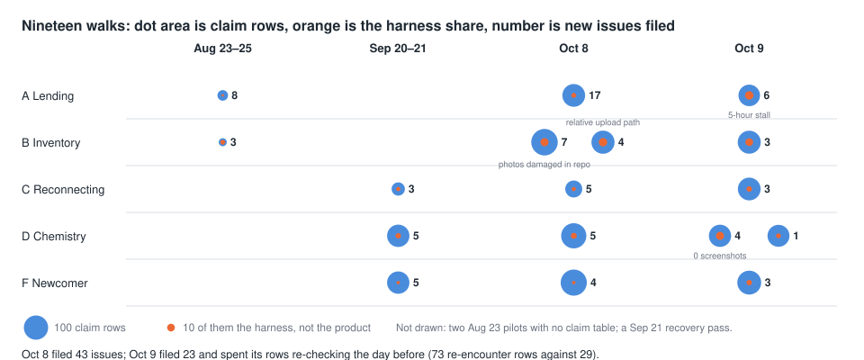

# Nineteen simulated-user walks; the last round confirmed every fix
## Simulated-user walks

Dot size: how much the simulated user reported; orange: test-setup noise. Rounds Aug 23–25, Sep 20–21, Oct 8, Oct 9.
