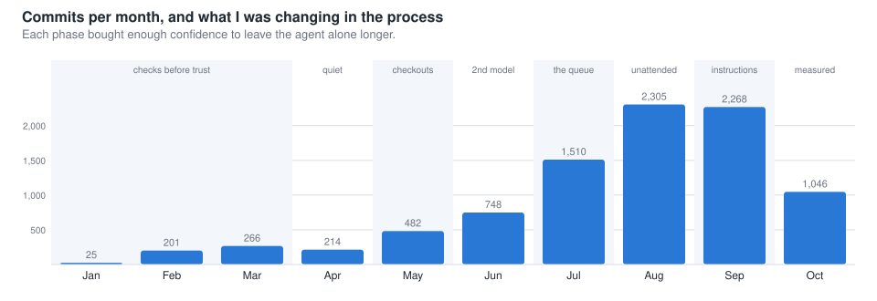
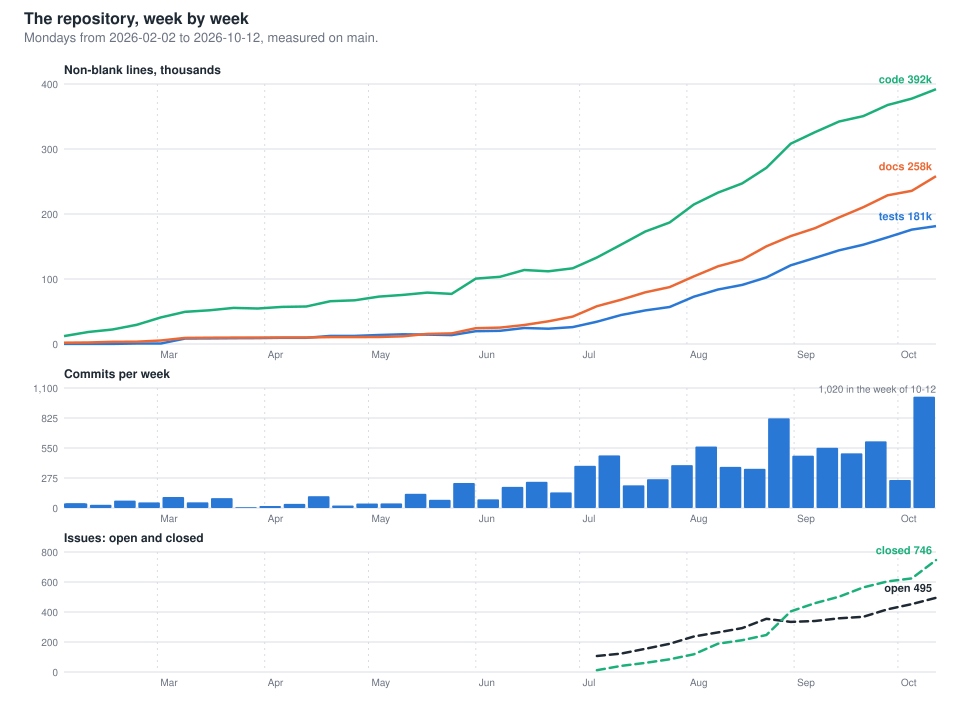
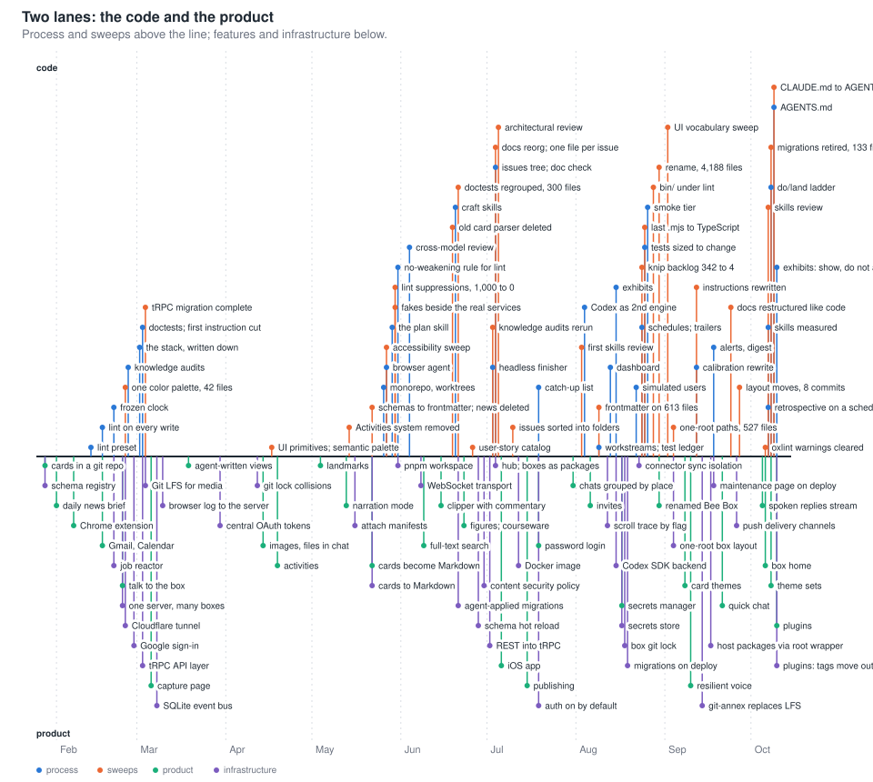
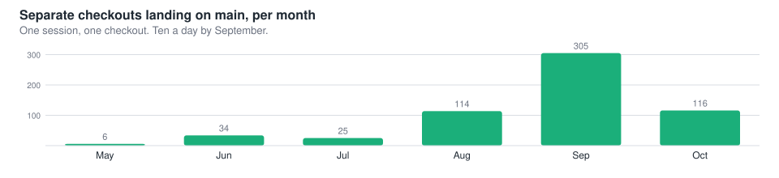
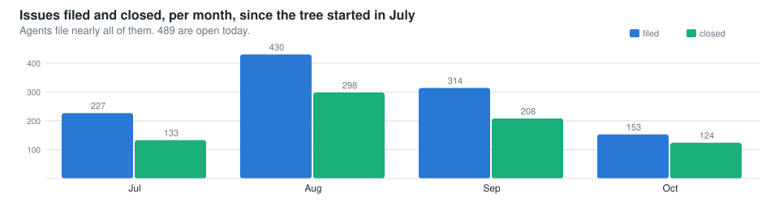
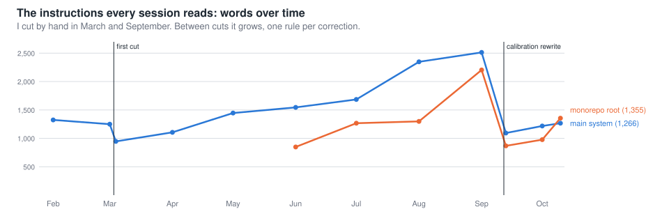
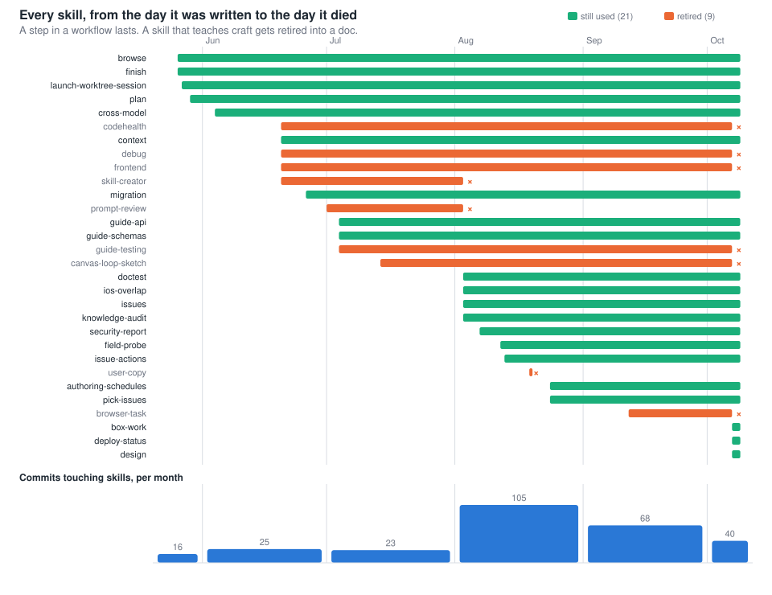

# Timeline: the approaches, in order

One line of thought: every step bought me enough confidence to leave the agent alone for longer, and the longer runs showed me the next thing I needed. Dates and commit hashes are in [the inventory](inventory.md); this page is the shape.

The weekly figure is measured from git objects by `dev/devprocess-talk/size-history.ts` (no checkout; a Monday's commit on main, lines classified the way the project-size tool does). Its data is in `dev/devprocess-talk/data/size-history.json`. Browser use is counted from the local session transcripts by `dev/devprocess-talk/transcript-stats.ts` (tool calls and sessions per week, no content), into `dev/devprocess-talk/data/transcript-stats.json`; local retention starts in late July, so the series does too.

To see the lanes at any scale, overlaid on the weekly stats, and to step through the talk's chapters ([chapters.md](chapters.md)): [explorer.html](explorer.html). The events are listed in [lanes.md](lanes.md), one line each; edit that file and rerun the generator.

Figures are generated by `dev/devprocess-talk/figures.ts`; the numbers are in its data block. Each phase below ends with what the product gained in the same span, from [the features sweep](reports/sweep-features.md).

## 1. Checks before trust (January to March)

One repo, one session at a time, me watching.

- **I started with lint and code checks.** A shared ESLint and TypeScript preset (Feb 13), then a hook that lints every file the moment the agent writes it (Feb 17), then Prettier in pre-commit (Mar 1). A card-validation plugin for the box's own data came even earlier (Feb 1).
- **Tests the agent could read.** The doctest framework (Mar 3): tests written as documents, output designed for an agent reading a pipe rather than a person reading a terminal.
- **Instructions got structure.** The first big cut of the package instructions, from 218 lines to 118, and nested instruction files per directory, both on Mar 3. A doc graph that knows which docs link to which (Mar 4). A line telling the agent to improve its own instructions (Mar 6).
- **I tried to grade sessions.** A session-critique tool (Mar 5). It ran 13 times and faded.
- **Why this mattered:** with lint, types, and tests running on every edit, a wrong agent move showed up in seconds. That is what let me stop watching.

**Meanwhile, in the product:** notes as typed cards in a git repository, a web view, RSS feeds, and a daily news brief an agent writes (Jan). The Chrome extension, Gmail and Calendar connectors, voice in and out (Feb). A capture page for audio and photos, share-to-box from the phone, and views that agents write for the person to open (Mar).

## 2. A quiet month (April)

214 commits. Product work, nothing new in the process.

**Meanwhile, in the product:** images and files dropped into chat, activities (guided, reusable sessions, language practice first), model choice and conversation compaction, batch photo import.

## 3. Longer sessions need separate checkouts (late May)

The checks had made longer runs safe. Longer runs made one checkout a bottleneck: two sessions editing the same tree clobber each other.

The other reason for the merge: the agent was equally good in every area at once. A person specializes, so five repositories matched five kinds of expertise; an agent does not, so a change that crosses the server, the extension, and the phone app is one piece of work. Since late August, 46 of 154 pieces of work have touched more than one package, and the most common pair is the iOS app with the server.

- **May 26, one day:** five repositories became one monorepo. Managed git worktrees, a per-worktree copy of the test box, one shared dev router so every checkout gets its own URL, a per-worktree browser the agent can drive, the first finish skill, and the rule that tool noise is a bug.
- **May 27:** a skill that launches a fresh session into its own worktree with a written briefing.
- **May 29:** the plan skill. Non-trivial work gets a plan doc before code.
- **May 30 to 31:** the merge revealed 1,000 silently disabled lint violations across 158 files. A ratchet took them to zero in two days, and the rule that the agent may not weaken a lint rule to pass went in the day the count hit zero.
- **Why this mattered:** now I could run several sessions at once. The question became how to know what any of them had done.

**Meanwhile, in the product:** landmarks as curated entry points with their own chats, narration mode (dictate while the box listens and answers briefly), an inbox triage pipeline, and cards rewritten from XML to readable Markdown (May 22).

## 4. A second pair of eyes (June)

- **Cross-model review (Jun 4):** Codex reviews what Claude built, before I look. It became the technique with the most recorded catches, and it reviewed most of the other gates on this page.
- **Test output for agents (Jun 9):** TAP output rewritten on the premise that the consumer is an agent reading a pipe.
- **Pages I can open (Jun 23):** tracked HTML and Markdown under a dev directory served by the router.
- **Skills, first wave (Jun 20):** one day, five craft skills: debug, code health, frontend, context, and a skill that writes skills. Guides for the API, schemas, and testing followed on Jul 4.
- **A catalog of what the product can do (Jun 26):** 413 user stories extracted from the code, later the seed for simulated walks.

**Meanwhile, in the product:** full-text search, a web clipper that keeps a frozen copy with the person's commentary, figure cards (interactive diagrams in notes and chat), courseware, push notifications.

## 5. The queue appears (July)

Commits doubled. Agents found more than they could fix, and the findings had nowhere to go.

- **Subagent definitions (Jul 3):** a headless finisher does merge and test churn out of the main chat. 56 worktree merges before it, 659 since.
- **One file per issue, directory is state (Jul 4):** the single ideas file split into an issues tree. Agents file as they go, with provenance written automatically; by October 98% of issues were agent-filed.
- **Doc check on every commit (Jul 4):** the end of skipping hooks on docs commits. The same day the root instructions were cut from 1,393 words to 807.
- **Agents sharing a worktree stopped racing on git (Jul 9):** path-scoped commits, after a commit race bug.
- **A tag for code that landed before I tried it (Jul 19):** the start of my catch-up list.

- **Plain-language style rules (Jul 30).** The same week I noticed skills were never being triggered, and their descriptions became the trigger.

**Meanwhile, in the product:** the native iOS app with offline capture, publishing selected cards as a static site with a leak scan, password login on by default, one server hosting many boxes, search by meaning, the agent asking for a screenshot of what you see, to-dos on any card.

## 6. Everything that runs without me (August)

The peak month. Most of the unattended machinery is from a three-week stretch.

- **Skills, second wave (Aug 3):** the first review pass. The skill-writer and prompt-review skills died; issues, doctest, and knowledge-audit were born. August is the peak month for skill edits with 105 commits, and the queue skills arrived: issue actions (Aug 13), pick issues (Aug 24), schedules (Aug 24). The 517-line plan skill became 100 lines plus a template (Aug 26).
- **Codex as a second engine (Aug 4)**, with liveness checks that fail closed so a sweep never deletes a running agent's checkout.
- **Workstream separate from worktree (Aug 8 to 9):** the unit of work outlived the checkout; registry, resume, and cull state followed. The test ledger started the same day.
- **A dashboard across streams (Aug 13)** and an issues browser; exhibits, a page of screenshots an agent publishes with one question (Aug 15); comments I leave on docs that the agent reads at pickup (Aug 22).
- **Simulated people walking the product (Aug 22)**, with an after-action pass two days later.
- **Schedules (Aug 24):** one launchd tick runs fifteen jobs; four hand-made plists retired. Commit trailers now record which workstream and plan every commit belongs to.
- **Tests sized to the change (Aug 25):** change-based selection, a flake policy of never rerunning to chase green, an hourly full suite that bisects, and finish scripts that choose the verification instead of the agent choosing it.
- **The smoke tier (Aug 26):** after three escapes in two days passed every check while the app was broken.
- **Product renamed (Aug 30):** 4,188 files, with a hook that keeps the old name out.

**Meanwhile, in the product:** invites, a secrets manager with per-agent grants, Codex as a chat engine beside Claude, Drive folder mounts, the laptop scan uploader, a new top bar, suggested questions on an empty chat. And the name.

## 7. Instructions as the bottleneck (September)

With the machinery in place, the limiting factor was what the agents were told.

- **The calibration rewrite (Sep 12):** root instructions cut from 2,242 words to 850, package instructions from 184 lines to 67, after a pilot that measured what sessions actually did against what the text said. Skill descriptions were shortened in the same pass.
- **A third model provider (Sep 14)**, little used.
- **A weekly refresh of agent-facing docs (Sep 16).**
- **Alerts, conditions, a daily digest (Sep 18):** scheduled work reports to one place.
- **Layout moves (Sep 27):** eight commits of 300 to 740 files, and a layout check that keeps paths honest afterward.

**Meanwhile, in the product:** card themes and prominence, voice recordings that survive disconnects and get a late correction, the browser-task card the extension fills in, quick search from anywhere, quick chat for short thoughts, managed publishing with custom hostnames, large media on git-annex.

## 8. Measuring the instructions themselves (October)

- **Skills reviewed against transcripts (Oct 7):** which skills sessions actually invoke. Six retired in one day, among them debug, frontend, code health, and the testing guide, their content moved into docs. Three born: box work, deploy status, design. A lint on skill size, and the rule that agent files only ever grow unless pruned, with mechanics moved into scripts.
- **A retrospective schedule (Oct 7)** under the principle "arrange context, don't automate judgment".
- **The "how much to do" ladder (Oct 8):** discuss, plan, do, land. "Go ahead" had meant four things.
- **One instruction file both agents read (Oct 9):** every CLAUDE.md renamed to AGENTS.md; the generated mirrors for Codex went away.

**Meanwhile, in the product:** ten theme collections, a home screen per box on web and iOS, spoken replies streamed as generated, capture from an iOS shortcut without opening the app, chats you can mark done, plugins.

## Skills, as one thread

| | Written | Still used | Examples |
|---|---|---|---|
| **A step in a workflow** | 18 | 18 | finish, launch a session, plan, cross-model review, issues, pick issues, schedules |
| **Teaching craft** | 12 | 3 | debug, frontend, code health, a testing guide, a skill that writes skills |

An agent reaches a workflow skill because the step has a name and a moment. It never reaches "be good at frontend" on its own, so that content went back into the docs. Two waves of writing (Jun 20, Aug 3) and two culls (Aug 3, Oct 7).

## The two arcs together

The process arc runs from checks, to checkouts, to a second model, to a queue, to unattended runs, to measuring the instructions. The product arc runs from an agent that files things into a repository, to a personal assistant a person talks to from a phone with the repository underneath. The product's widest months, July and August, are the months the process stopped needing me in the loop for each change.

## The pattern

| Period | What I could leave alone | What that exposed |
|---|---|---|
| Jan to Mar | one edit at a time, checked instantly | sessions could run longer, in one tree |
| late May | a whole session, in its own checkout | several sessions, nobody reviewing |
| June | a session plus a second model's review | more findings than I could hold in my head |
| July | a session that files its own issues | a queue; code landing before I tried it |
| August | a day of scheduled work | checks passing while the app was broken; my attention |
| Sep to Oct | the instructions themselves, measured | whatever is next |

Illustrations in `figures/` are drawn by the Gemini image script in `beebox/src/dev/gen-image.ts` from the prompt file beside each image (`<name>.prompt.txt`); `cast.png` is the character reference sheet, passed with `-i` so every scene shares the same two characters.
