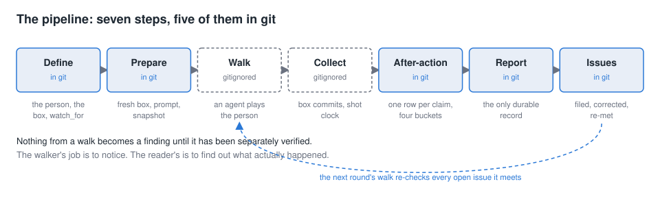
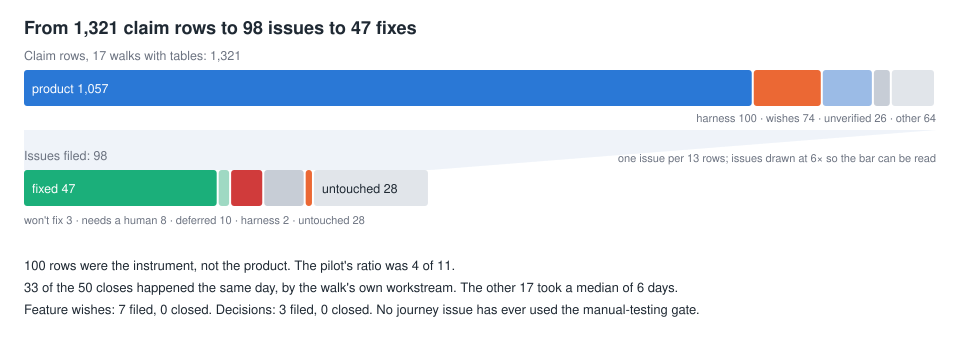

# User-story journeys: what they are, what they find, what happens next

A standing overview of the journey walks: the intent, the choices behind them, the walks that have run, what the walkers say, the issues that come out, and how those issues are resolved. Every number below came from the repository on 2026-10-10 and the command that produced it is in the two sweep reports under [reports/](reports/). Walker notes, screenshots and box snapshots are gitignored, so quotes come from the tracked reports, which quote the notes.

Sources: [the design plan](../../beebox/docs/plans/user-story-journeys.md), [the journeys README](../../beebox/test/user-stories/journeys/README.md), [the walker prompt](../../beebox/test/user-stories/journeys/walker-prompt.md), [the after-action procedure](../../beebox/test/user-stories/journeys/after-action.md), the reports under `beebox/test/user-stories/journeys/<journey>/reports/`, and `issues/`.

## 1. What a journey is for

The capability catalog of 2026-08-21 holds 649 statements of the form "the product can do X". The plan opens by naming what that cannot see: "It has no notion of a person with a motive." A journey is "a goal from someone's life with a reason attached, because the reason decides what a good outcome looks like." An agent with a browser plays that person, knowing one sentence ("an AI-powered app for organising your life") and no product words, walks a fresh box for an evening's worth of actions, and writes notes in character. A second pass turns the notes into verified findings and issues.

The plan's central prediction is that the usual outcome is not wrong behavior but "data turns up and the box has no shape to put it in", which it calls the ordinary condition of a box that has not been taught anything. So the reader watches whether the box notices, asks, proposes a shape, or files the thing somewhere generic.

## 2. The pipeline

| Step | What happens | Where | Tracked? |
|---|---|---|---|
| Define | `journey.yaml`: the box's starting state, assets, the situation in the person's words, a closing ask, and `watch_for` notes that only the reader sees | `journeys/<id>/journey.yaml` | yes; B's two tray photos committed |
| Prepare | builds a fresh box with its own git history, registers it with the router, places assets, composes the prompt from the walker template, snapshots the box, checks the app renders; refuses to run while an earlier walk has notes but no report | `journeys/prepare/core.ts` | script yes; output under `user-stories-work/` no |
| Walk | an agent drives `bin/browse` for the budget (50 to 60 actions), screenshots each step, appends notes as it goes; may read one clock script and nothing else in the repo | the agent, `walker-prompt.md` | notes and shots no |
| Collect | reads the box's own commits and the screenshot timestamps "independently of what the walker says"; timing never comes from the notes | `collect.ts`, `agent-time.ts` | script yes |
| After-action | one row per claim; each classified product, harness, environment or unverified; harness checklist first; investigate survivors to a file and line or a reproduction; file; a last pass asking "is every claim in there?" | `after-action.md` | yes |
| Report | run table, what landed, timing, the findings table, harness defects, not verified. "The only part of a run that is tracked." | `<id>/reports/<date>.md` | yes |
| Issues | real findings filed; a wrong one is corrected in place; a later walk that hits an existing issue adds a dated re-encounter note, which can set a `discuss` action for the human | `issues/` | yes |

The report is the durable record. Once a run's `user-stories-work/` directory is pruned, the report and the issues are what is left.

## 3. The choices, and what each one bought

| Choice | Why | What happened |
|---|---|---|
| The walker knows one sentence and no vocabulary | "Less is implausible; more gives away the map" | Vocabulary findings in every walk: "Landmarks — I've used the page a dozen times and I still couldn't define it." |
| Asking the assistant is first-class, not cheating | "If the fastest route to every goal turns out to be 'ask the agent', that is a finding about the product" | It became the finding. In the first pilot it was the only path that worked; in October: "talk to it, don't click around" |
| Push through; giving up is a last resort | A capable model is more persistent than a newcomer, "and that is fine" | One near-give-up in 20 walks (the first pilot, at a login wall). October's B walker tried three upload routes, made resized copies, and carried on |
| The walker does not judge its own success | "someone who believes they filed their stuff and did not is a finding" | Every report opens "From the box, not the notes." From the third walk on, the two agree |
| Notes in character, loose, under five prompts | "Loose prose invites a travelogue"; the prediction before each action "exposes what the interface led me to expect" | The biggest wish of one walk sat under "what I wish I had" and was missed on first read; the procedure now says to harvest the closing sections |
| Nothing is a finding until verified | "a walker attributes to the product something the harness did" has happened every round | Three of seven bugs in the first real walk were the harness; in October a walk's headline "my photos cannot get in, three ways, all fail" was one relative path in the upload command |
| No wall clock for the walker | note-writing inflates elapsed time; a walker "convinced itself a two-minute wait had taken twenty" | Timing comes from screenshot timestamps and transcripts; reports separate agent time from "instrument overhead" |
| Assets only where the run needs them | "A person who is handed two photos will treat the photos as the job" | Four of five journeys carry none |
| A fresh box, none of the test box's chat state | the pilot "opened mid-sentence inside a stranger's chemistry course" | All five journeys start from an empty box; per-run paths since Aug 24 |
| No microphone | recording is interactive in ways a simulated person cannot drive | One mic finding reclassified as harness and closed |

## 4. The people

| Journey | The person and what they want | Box starts with | The reader watches for | Walks |
|---|---|---|---|---|
| A, lending | Lends books, tools and camping gear, has twice rebought something sitting in a friend's garage; remembers five lends with varying confidence. In a month: who has what, what I owe, what to chase | empty box, no assets | whether a return closes something or piles a contradicting sentence on top; whether doubt survives un-hardened; whether people become a thing | 3 (+1 recovery pass) |
| B, inventory | A workroom tray of oddments; bought a glue stick and found three. Wants to stand in a shop and ask "do I already have one, and where" | empty box, two photos of the tray | there is no inventory card type, so can the box be bent to the shape the person brought; hedged counts; can they say where their list lives | 6 |
| C, reconnecting | Four drifted friendships, each with an uncertain fact. Wants words they would really send, "without turning relationships into chores" | empty box, no assets | an actionable next step vs a pile of profiles; drafts that do not assert unknown facts; drafted, sent and agreed kept apart | 3 |
| D, chemistry | Self-taught, an hour most evenings, notes split across a notebook and a phone, keeps rereading the beginning | empty box, no assets (the handwritten-notes variant was never provisioned) | read vs practised vs demonstrated; mastery not claimed before the person answers; wrong answers kept visible | 4 |
| F, newcomer | A friend set it up. Wants to come back with a list of what they would use it for and what they wrongly assumed it would do | empty box, no assets | understanding vs observation; "do not convert 'I couldn't find it' into 'the product cannot do it'"; a decision not to adopt is valid | 3 |

**E, the school schedule, was never built.** It needed mail to arrive in a second sitting with the box reacting unattended, and anonymized mail from a real inbox that waits on the boxholder's review before it enters the repo. The `.gitignore` entry for its assets exists; the directory does not. The unattended-arrival mechanic was never implemented either: journey boxes are never ticked by the scheduler, which every report notes under "not verified".

## 5. The rounds

Four rounds, 20 reports (19 walks and one recovery pass). Each round ran against the harness of its day; each report's run table names the harness commit.

| Round | Walks | What the round was | What it found | What it taught the harness |
|---|---|---|---|---|
| Aug 23 to 25 | B twice, B, A | Pilots. The first two B walks shared a box and ran before clicks could be verified; the B walk of Aug 24 was the first with per-claim classification; A on Aug 25 was recovered a month later from a lost worktree | B: 20 record cards from two photos, "do I have a glue stick?" answered "four, don't buy a fifth". A: a lending ledger that kept doubt as doubt, which the walker called "the single best thing in this app". The front door is an empty chat box | 3 of 7 reported bugs were the harness (owner auth, a missing scroll instruction, transcripts surviving a box wipe); the walker "convinced itself a two-minute wait had taken twenty", which is why a clock script exists |
| Sep 20 to 21 | C, D, F | First walks of the three remaining journeys, after rebuilding prepare for a layout change | C: drafts rewritten in the person's words, "chat is easier than page manipulation". D: a full course built without the person naming any of it, one wrong chemistry rule, a link written before its target existed. F: "would use Spanish practice and household context, but keep appointments and reminders elsewhere" | the "cannot scroll" claim was a missing pane selector; a first-screen diagnosis was reversed on review (openers existed; a reserved session id skipped them); a name guard refused visible search results |
| Oct 8 | A, B, B, C, D, F | All five journeys in one day, two months after the pilots | The job itself went better: "The failures moved from the agent to the interface around it." A: one card per item, a direction field, correct cold answers. B: a correction loop updating pages live. C: the box agent offered to read the person's Gmail. D: a 73 s turn with only "Thinking…". F: a reminder "the agent knows will reach nobody". 40 new issues, 15 re-encounters, 20 of the issues fixed the same day | the repository's JPEGs had been damaged by a rename commit, so a walk's photo complaints were ours; "my photos cannot get in, three ways, all fail" was one relative path in the upload command; a 406-second "wait" was screenshot ordering; the box agent carried the developer's connectors |
| Oct 9 | A, B, C, D, D, F | Overnight re-run after the arrival, openers, chat-title and connector fixes | Everything the Oct 8 walkers hit hardest is fixed and confirmed: openers, the doubled place name, conversation titles, host connectors, the render loop, the plate badge, the scope glob. The same work introduced the round's main defect: a root place page saying "Nothing here yet" beside a box full of cards ("If I came back tomorrow and landed on this, I'd think it had lost everything"). B's photo capture finally worked and produced 33 record cards. 21 new issues, 26 re-encounters | a sleeping display hangs screenshots (one walk has none); a sleeping machine stalled a walk five hours and the router stopped its box; the browse cookie expired at 30 minutes and the "session ended" bar was taken for product; the persona's evening runs in the box's morning; chat-title runs are full agent sessions |

The pattern across rounds: each round's biggest product finding is fixed before the next, and the fix brings a smaller defect in the surface that fixed it. Each round also finds two or three faults in the instrument, and the reports say whether those were landed. The walks have so far found as much about the harness as about the product, which the after-action procedure predicted: "that only stops being true if each round's lessons are actually landed."

What the reports say improved, in their own words:

- Aug 23 to 24: "The two agree throughout, which had not happened before." (the box's commits and the walker's notes)
- Aug to Oct, lending: "The August walk tracked one ledger document. This walk produced one structured card per item, a direction field, an explicit uncertainty flag, dated nudges, and a correct answer from a fresh chat. The failures moved from the agent to the interface around it."
- Sep to Oct, reconnecting and newcomer: document metadata displacement "Fixed, confirmed"; tick controls "Fixed, confirmed. Checkboxes render and work."
- Oct 8 to 9, newcomer: "No regression of an item that was fixed. Landmark arrival introduced the root place page that says 'Nothing here yet' beside a working list."
- Oct 8 to 9, inventory: counts in prose "Changed. One record per item. New cost: the record front is empty."

## 6. What the walks sound like

The notes are in character, and the reports quote them. A range:

- Delight at a line the agent wrote into the ledger about an uncertain lend: "the single best thing in this app."
- Told a page does not exist and then offered it: "the most interesting sentence anyone has said to me tonight."
- The shop test, two months apart: "do I have a glue stick?" → "Yes — four… Don't buy a fifth." and later "12 s is a long stare in a shop."
- Confusion: "Landmarks — I've used the page a dozen times and I still couldn't define it." And a control never pressed: "Source" next to "Card" — "I never dared press it."
- Suspicion: promised notes that could not be found, "either it lied or they're somewhere I can't see."
- Unease at the machinery showing through: mid-turn, "Now the schema." The report adds: the walker does not know what a schema is. Another walker: "worried I'm steering a machine I don't understand."
- Lost: "I lost my chat with the two panels."
- Judgment: "A reminder that the agent knows will reach nobody is absurd." "The catch: I have to come and ask."
- Misreading the harness as the product: "my actual photos cannot get in. Three ways, all fail." (one relative path); the photo route "wants decent photos (it told me mine were stripy)" (the repository's JPEGs had been damaged by a rename commit).
- The closing verdict of the October lending walk: "talk to it, don't click around."

The last two groups are why the after-action pass exists. The walker is the instrument, and the instrument's errors read exactly like product defects.

## 7. From claim to issue

Every walker claim gets a row and a bucket before anything is filed. Across the 17 walks with claim tables:

| Stage | Count |
|---|---:|
| Walks | 19 (and one recovery pass) |
| Claim rows | 1,321 |
| of which product (defect or positive) | 1,057 |
| of which harness | 100 |
| of which wishes | 74 |
| of which unverified | 26 |
| of which dissolved by the walker's own evidence | 6 |
| Issues filed | 98 |
| Pre-existing issues re-hit and annotated | 22 |
| Re-encounter notes written, Oct 8 and Oct 9 | 15 and 24 |

Roughly one issue per 13 claim rows. Most product rows go "report only" or become evidence on an existing issue; one issue often collects rows from several walks (the activity-row issue gathered seven rows across four walks). The harness share is steady at about 8 percent of rows, and in the pilot it was 4 of 11. The round that filed the most was Oct 8 with 43; the Oct 9 round filed 23 and spent its rows re-checking the day before (73 re-encounter rows against 29 the day before).

Named and deliberately not filed: a photo-format rejection seen only with a damaged file, a chemistry session duration the model invented, a repeated card name whose cause was not traced, and an audio warning with conflicting evidence. Environment facts (no speech key, no scheduler tick) are never filed, by rule.

## 8. What the issues are

One kind per issue, the dominant one, assigned by reading all 98:

| Kind | Issues | Open | Closed | Examples |
|---|---:|---:|---:|---|
| Functional product defect | 29 | 13 | 16 | a chat timer over 25 days fires instantly (32-bit overflow); a React update loop after every turn with an open card; a search section hit opens the doc at the top |
| Vocabulary, wording, discoverability | 25 | 11 | 14 | the plate header printed "Scope: _content (**)"; activity rows say "ran 2 commands"; one pink bar for three severities |
| Assistant behavior | 12 | 6 | 6 | promises a reminder before checking whether notifications exist; narrates "Now the schema." to a person who asked for a list; one wrong chemistry rule |
| Navigation, layout, placement | 9 | 4 | 5 | the plate badge opened Browse and hid the chat; switching place opened an empty chat; an open card silently followed into the trash |
| Missing feature, a wish made concrete | 7 | 7 | 0 | the first screen says nothing about what this is; a drafted message has no copy control; a study home with last and next |
| Harness or walker tooling | 6 | 2 | 4 | a name guard refused visible search results; the turn counter counted title runs; the box agent could read the walk notes |
| Accessibility naming | 4 | 1 | 3 | a checkbox named by its status; tab names that are file paths; image alt text numbering content blocks |
| Product decision needed | 3 | 3 | 0 | chats bind to a landmark once and never move; structured card fronts hide their facts; the root place page says "Nothing here yet" |
| Privacy or isolation boundary | 3 | 1 | 2 | the box agent inherited the developer's Gmail and Calendar connectors (fixed same day); the host login email in every box session (open) |

Two readings. The walkers read accessible names rather than pixels, so they found accessibility defects a sighted person would miss, and they also misread the accessibility tree as the screen. And the kinds sort by what closes them: defects and wording close; feature wishes have never closed; assistant-behavior issues close only through guidance changes, which the next walk may or may not confirm.

## 9. What happens to them

Of the 98 issues, 50 are closed (47 implemented, 3 won't fix) and 48 open.

**Two speeds.** When the walk's own workstream fixes what it found, the close is the same day: 33 of 50 closes, 31 of them in the two October rounds. When an issue waits for a planned workstream, the median is 6 days and the range runs to 31; those closes came from the todos, live-vs-stored, card-reading, vocabulary and small-bugs streams, and the next walk usually confirms them in its "since last time" table. There is nothing in between: no journey issue has been closed by a pick-from-the-queue session except two small batches.

**What the next walk confirmed.** The Oct 9 round checked every Oct 8 fix it could reach and found none regressed: openers, the doubled place name, conversation titles, host connectors, the render loop, the plate badge, the scope glob, tab names, the landmark pages. One class of close is weaker: four assistant-behavior issues closed on Oct 9 by a guidance change, and the Oct 9 walks, run the same morning, still saw three of them. Those closes mean "guidance landed", not "behavior changed".

**Why the 48 are open.**

| Group | Count | What it looks like |
|---|---:|---|
| Waiting on a human decision | 8 | four `needs: [decision]` (chats bind to a landmark, since Aug 25; structured card fronts; what to show during a 73 s turn; the empty root place page) and four `discuss` actions set by the re-encounter rule when a recurrence made the priority look stale |
| Deferred by label or priority | 10 | four `low`, four `backlog`, two August agent-behavior items no walk has seen since |
| Harness side | 2 | the box agent can read walk notes; the browse key is not a signed-in owner |
| Nobody has picked it up | 28 | 24 from the two October rounds, untriaged (neither October round has a priority set); four older, two of them `important`: the first screen says nothing (re-encountered in every round, four dated notes) and one pink bar for three severities |

**Gates.** No journey issue has ever carried the manual-testing gate. The fixing agent verified in the browser and closed, or the issue stayed open. The one rule-driven path to the human is the re-encounter convention: a later walk that hits an open issue adds a dated note, and if the priority may be stale it sets `discuss`, which is how six journey issues reached the human's queue.

**A second pipeline with no issue files.** Every report ends with a harness-defects list. Most entries read "Fixed: sha" inline and never enter `issues/`: the relative upload path, the damaged JPEGs, the turn counter, the cookie expiry.

## 10. Five issues, whole life

**Fast: the scope glob.** Three Oct 8 walkers hit the same line; one called "Scope: _content (**), plus todos elsewhere that link here" gibberish. The report named the component and line. Filed and fixed the same day ("Describe the plate scope in words instead of a glob"); the closing note says `**` now reads "the whole box". Oct 9 confirmed it in two walks.

**Slow: document metadata displaces the reading view.** The Sep 21 reconnecting walk saw `contains`, `prominence`, `symbol/glyph` before any useful content; the same day's chemistry and newcomer walks appended re-encounters. It waited 15 days for a planned card-reading workstream. The Oct 8 walks: "Fixed, confirmed. Shots 05 and 07 show the title, the '4 open' summary, then the body." The chemistry walk found the leftover, the same field dump in chat embeds, and filed it separately.

**Won't fix: the isotope rule.** The tutor told the Sep 21 chemistry walker that isotopes are neutral and ions are not. Filed as a teaching error with the screenshot. Closed three days later by the boxholder: "the particulars of one bad lesson are model output, not a defect in beebox." The next two chemistry walks checked anyway: "Not repeated."

**Still open, needs a human: chats bind to a landmark once and never move.** Filed Aug 25 with three options and `needs: [decision]`. The September recovery pass re-read the code: still bound once. The Oct 8 lending walk: "I lost my chat with the two panels." The Oct 9 walk hit it again under the new "Go to Loans" button. Forty-six days, three walks, a `discuss` action, no decision.

**Re-encountered six times, then fixed: fresh-chat openers.** The Sep 21 newcomer walk read it as a missing feature; the review corrected the diagnosis to a reserved session id skipping the gate. It sat 17 days. Every Oct 8 walk hit it on its first screenshot; the issue got one consolidated note: "Still present in every 2026-10-08 walk." The landmark-arrival plan closed it that day. All six Oct 9 walks: fixed. The same plan introduced the root place page that says "Nothing here yet" beside a box full of cards, which is the Oct 9 round's decision item.

## 11. What keeps coming back

Frictions that several walks report, with where they stand after Oct 9:

| Friction | Walks that hit it | Standing |
|---|---|---|
| The first screen says nothing; no openers | every walk from Aug 25 to Oct 8 | openers fixed Oct 9 in all six walks; the first-screen issue "partly met"; the root place page's "Nothing here yet" replaced it as the main complaint |
| No one front door to the collection | B Aug, A Aug, A Oct, B Oct ("the walk's biggest wish") | "partly met" by place pages on Oct 9; the collection-views issue is still open |
| Activity rows speak in commands and files ("ran 2 commands", "Wrote schemas/loan.ts") | A, C, D, F in October, all six Oct 9 walks | still present; one walker would rather see "one word like 'saved'" |
| The agent promises delivery it cannot make (reminders, calendar) | F Sep, C Oct, F Oct, A Oct 9 | a guide rule was added Sep 26 and "the notify class recurred despite the guide rule"; smaller on Oct 9 |
| Implementation vocabulary on screen (landmark, `_content`, Prominence, "the boxholder") | B Aug, C Sep, A, D, F Oct, B Oct 9 | partly fixed (scope glob, pill, tab names); "the boxholder" and paths in the plate remain |
| The plate badge opens Browse and hides the chat | F Sep, A, C, F Oct | fixed Oct 8, confirmed Oct 9 |
| Conversations never get a title | F Sep, B, C, F Oct | fixed Oct 8, confirmed Oct 9; the fix's title runs are now their own issue (full agent sessions, one read box files) |
| Chats bind to a landmark once and never move | A Aug, A Oct, A Oct 9 | needs a human decision since Aug 25; three options in the issue |
| Structured card fronts hide their facts | A Oct, B and D Oct 9 ("the walker's biggest complaint again") | revisits a decided design; needs a decision |
| The walker reads the accessibility tree as the screen | A, D, F Oct; worse on Oct 9 with no screenshots | a harness property; the after-action checklist names it |

## 12. Limits of the record, and how to refresh this page

- The figures are generated from the sweep numbers by `dev/journeys/figures.ts`; edit its data block and run `node --import tsx dev/journeys/figures.ts`.

- Timing covers Claude root chats only, to first text, not completion; October reports hand-compute completion from screenshots.
- Journey boxes are never ticked, so any reminder or schedule claim is "not verified" by construction.
- The walker is an agent under evaluation, and an agent under evaluation can go rogue. Inside the box the after-run review mostly catches it: a step the walker reports with no screenshot, or a box file changed without a matching action in the transcript, shows up in the report or the collector. The harder case is the walker leaving the box altogether, reading or changing the dev checkout, another box, or the machine, to get the result it was asked for. Nothing in the harness prevents that, and the after-run review only looks inside the box. The same caveat applies to every other eval in the repo that scores an agent on its own run.
- The harness defects each report lists form a second pipeline with no issue files: most are "Fixed: sha" inline and never enter `issues/`.
- Closed issues often name their fix in the opening note rather than a commit trailer; only a minority of closes carry an `Issue:` trailer, so "what fixed it" needs the issue text, not just `git log`.
- The two sweeps under [reports/](reports/) carry the commands. To refresh: rerun the issue-set build (`discovered-in` naming a journey, union the basenames the reports cite, drop pre-existing issues), recount the claim tables, and append the new round's reports.
